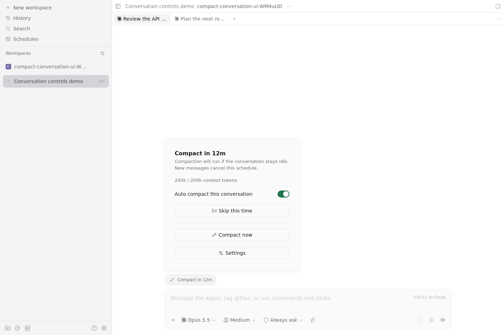

# Auto Compact for Claude

Automatically compact large, idle Claude conversations in Paseo before their prompt cache expires. Summarizing while the history is still cached leaves less uncached input to process when you return, which can reduce usage and response delays. [How this helps](https://code.claude.com/docs/en/prompt-caching#compacting-the-conversation).



*Paseo web app with sample data.*

## Why this exists

Claude Code [added idle auto-compaction](https://github.com/anthropics/claude-code/releases/tag/v2.1.299) to summarize large conversations before cache expiry. Paseo does not yet use this feature. This plugin fills that gap **until Paseo supports it natively**.

Codex subscription sessions do not need this plugin: [caches are retained indefinitely for logged-in Codex users](https://x.com/thsottiaux/status/2112712984644784534).

## Requirements

- **Paseo 0.12 or later**.
- A Claude provider using a native Claude Code CLI that supports Mods. Claude profiles are supported too.
- The Paseo web, desktop or Android app. The iOS app is unverified.

Supported Claude versions and setup help: [troubleshooting](docs/runtime.md).

## Install

On the machine running the Paseo daemon, install directly from the public GitHub repository. Git must be available on that machine:

```sh
paseo plugin install github:babo-jeonguk/paseo-auto-compact-for-claude
```

Or paste `github:babo-jeonguk/paseo-auto-compact-for-claude` into **Settings → Plugins → Plugin source** and select **Install plugin**. Turn on **Enable plugins** and enable **Auto Compact for Claude**, then start or reopen a Claude conversation. After a reply finishes, open the pill beside the message composer to see its schedule or why it is waiting.

This direct GitHub installation works before registry approval. Start or reopen a Claude conversation after installation. [Setup and compatibility](docs/runtime.md).

## Use

The conversation pill is available even below the token threshold.

The pill uses five states:

| Label | Meaning |
| --- | --- |
| **Compact off** | Automatic compaction is disabled. Open the pill to see which setting controls it. |
| **Compact on** | Automation is enabled and waiting for scheduling conditions. A previous cancellation, expiry, skip or success does not turn it off. |
| **Compact in …** | A current reservation has a countdown. New messages cancel that reservation. |
| **Compacting…** | Compaction is running; wait before sending a message. |
| **Check compact** | Open the pill for the problem and next action, such as checking the conversation, reopening the session or correcting settings. |

Open the pill for the current reason and any action needed. Brief refreshes and setting changes use a loading indicator. If **Check compact** persists, open the pill for the suggested next step.

- **Automation switch:** enable or disable automatic compaction for this conversation.
- **Skip this time:** cancel the current reservation without changing automation settings. The button stays visible and is disabled when there is no eligible schedule.
- **Undo skip:** restore the original scheduled time while the reservation is still valid. New activity or an expired deadline prevents undo.
- **Compact now:** compact after confirmation, regardless of automation switches, the automatic token threshold or whether context usage is available. The control acknowledges the persisted operation immediately, shows **Compacting…**, and reports the matching final result as it arrives, even after the controls are closed or the plugin restarts. A request is never sent twice. If nothing could be sent, the result says why, and you can try again once that is resolved. Keep the conversation idle and stop background work first.

Near a scheduled time, skip or turn automation off and wait for confirmation before sending new work. During **Compacting…**, wait for completion.

Open **Settings** from the pill to change the host-wide defaults: **automation on, 200,000 tokens, 55 minutes after a reply finishes**, with all Claude providers enabled. [View settings](assets/settings.png).

When the cache lifetime is unavailable, the plugin assumes one hour. A known five-minute cache window cannot cover the default 55-minute delay. Installing or updating does not schedule existing conversations retroactively. Compaction consumes tokens and may lose detail; cache hits and savings are not guaranteed.

## Update

Review and apply available updates on the daemon machine:

```sh
paseo plugin update auto-compact-for-claude
```

Review the proposed commit before confirming. Direct GitHub updates follow the repository's default branch. Reopen Claude sessions after an update so they use the new version.

On Paseo 0.14, Paseo reopens a session itself before its next message. Until then, the plugin does not compact that conversation: send a message and wait for the reply first. A countdown from before the update does not run; that reply schedules a new one.

## Remove

Turn automation off in Settings, then remove the plugin:

```sh
paseo plugin remove auto-compact-for-claude
```

Reopen remaining sessions when convenient to finish removing the plugin.

[Setup and troubleshooting](docs/runtime.md) · [Paseo 0.14 compatibility research](docs/research/paseo-0.14.0-project-impact-2026-10-29.md) · [Third-party notices](THIRD_PARTY_NOTICES.md)
